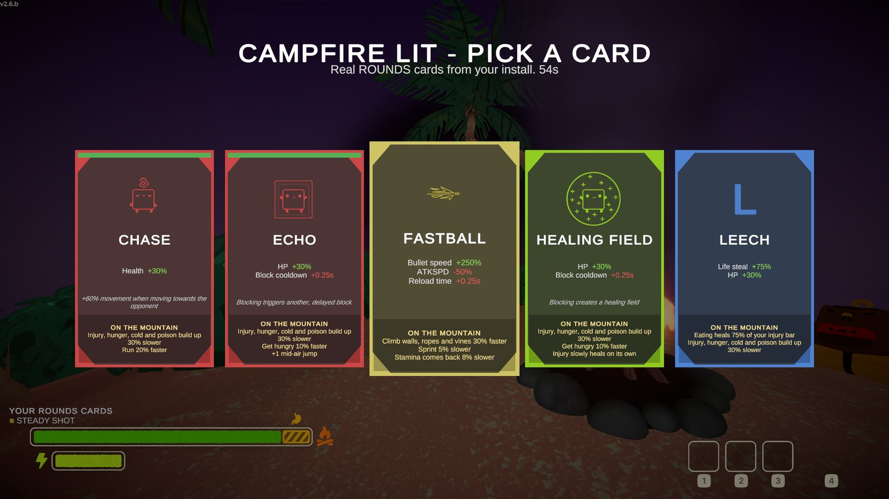

# PEAK x ROUNDS: Campfire Cards

Climb PEAK with ROUNDS's cards. Every time your group lights a campfire (and once on the beach before the climb),
each climber picks one real ROUNDS card: its name, text, stats, colours, icon and pick sounds are read straight from
your own ROUNDS install while PEAK runs. The card's ROUNDS stats are remapped to the mountain, for example:

- **HP**: toughness. Injury, hunger, cold and poison build up slower (or faster for Glass Cannon).
- **DMG**: how hard you throw items.
- **Reload time / speed**: how fast stamina comes back.
- **Ammo / Bullets**: bonus stamina at every campfire.
- **Bullet speed**: climbing speed on walls, ropes and vines.
- **Bounces / Bouncy**: less fall damage, or landings that bounce you back up.
- **Block cooldown**: hunger.
- **Phoenix**: once per climb, passing out is cancelled and you get up healed.
- **Life steal**: eating heals injury.

ROUNDS's rule applies: the **last climber to reach the fire picks first**, and friends see "X is picking a card..."
while you choose. 58 of ROUNDS's 67 cards have a climbing meaning in this version; the rest stay in ROUNDS.



## You need
- **PEAK** with **BepInEx 5** ([BepInExPack PEAK](https://thunderstore.io/c/peak/p/BepInEx/BepInExPack_PEAK/)).
- **ROUNDS** installed on the same PC (Steam). The mod finds it through your Steam library. Without ROUNDS the climb
  is normal PEAK and a notice says cards cannot be dealt.

No ROUNDS or PEAK files are included here or in the release: every player brings their own copy of both games.

## Install
Copy the `plugins/PeakRounds` folder from the release zip into `PEAK/BepInEx/plugins/`, then start PEAK.

## Playing together
Co-op for up to 4, exactly like PEAK: host a game and invite friends through Steam. Every player needs this mod and
their own ROUNDS install. Card picks are synced over PEAK's own network; late joiners receive everyone's cards.

## Config
`BepInEx/config/thejokehive.peakrounds.cfg`: `RoundsPath` (only if Steam detection fails), `Sounds`,
`PickTimeoutSeconds` (safety timer, default 60). `Debug.DevKeys` turns on testing keys for the host:
F9 lights the current campfire, F10 warps you to it, F11 shows a sample card fan.

## Building from source
Requirements: .NET SDK 8 or newer, Python 3, and PEAK with BepInEx installed (the project references PEAK's own
assemblies from its install folder; set `PEAK_DIR=<folder>` if PEAK is not in the default Steam location).

```bash
tools/build.sh            # regenerate code from the design sheets, preflight, compile, package
tools/build.sh --install  # same, then copy the plugin into your local PEAK
```

The output is `build/PeakRounds-<version>.zip`.

## How the project is organised
- `design/` holds the JSON design sheets (cards, climb stats, game hooks, network events, UI, ROUNDS assets,
  systems). They are the source of truth; see `design/README.md`.
- `tools/gen.py` turns the sheets into `src/PeakRounds/Generated/*.cs`; `tools/preflight.py` checks that every cell is
  filled and every cross-reference resolves before a build.
- `src/PeakRounds/` is the BepInEx plugin: Harmony hooks into PEAK, the ROUNDS asset reader (AssetsTools.NET), the
  ROUNDS sound decoder (FSB5 Vorbis via NVorbis), the deck, effects, pick sessions, Photon sync and the card UI.
- `lib/` holds the bundled third-party libraries (all MIT, see `LICENSES.txt`).

## Credits
Design and code: NotNic. ROUNDS is by Landfall Games; PEAK is by Aggro Crab and Landcrab.
This is a fan mod and is not affiliated with either studio. Bundled libraries and their licenses: see `LICENSES.txt`.

## License
MIT, see `LICENSE`. The bundled libraries keep their own licenses.
